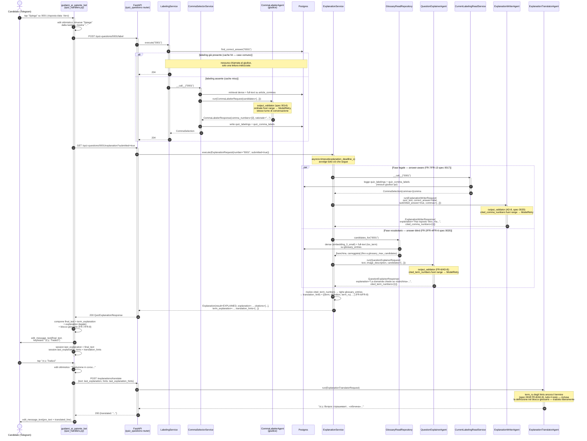

<!--
Non-normative companion to Spec 0020 (docs/superpowers/specs/2026-09-21-question-explanation-design.md).
This file carries no Status/lifecycle of its own — it is a worked-example walkthrough of
the flow Spec 0020 (extending Spec 0017) defines, kept alongside it for readability. The
spec's FR/AD numbers remain the source of truth; if this file and the spec ever disagree,
the spec wins and this file is stale and should be regenerated.
-->

# Flusso completo di una chiamata a "Spiega" (Spec 0017 + Spec 0020)

Cammino end-to-end di un tap su "Spiega" in chat, con i due agenti (giudice + writer +
vocabolario) e il round-trip di traduzione. Esempio concreto usato in tutto il documento:

- **Domanda 0001**: *"La sosta sulla banchina è consentita ai velocipedi?"*
- **Risposta corretta**: `Falso`
- **Risposta data dal candidato**: `Vero` (sbagliata)

## Diagramma di sequenza



## Chi fa cosa, e quando

| Componente | Tipo | Quando entra in gioco | Responsabilità |
|---|---|---|---|
| `handle_explain_callback` | Bot handler | Tap su "Spiega" | Orchestrazione lato bot: edit ottimistico, chiama `/label` poi `/explanation` in sequenza, compone `final_text`, stasha la sessione (FR-7). |
| `POST /{number}/label` | Endpoint | Sempre, prima di `/explanation` | Garantisce che una labeling esista; **unico punto** in cui gira il giudice (spec 0017 AD-1). |
| `LabelingService` | Service (`@service`) | Dentro `/label` | Existence check + deadline (`labeling_deadline_s`) attorno a `CommaSelectorService`. |
| `CommaSelectorService` | Service | Solo su cache-miss | Retrieval + giudice + scrittura `quiz_labelings`/`quiz_comma_labels`. **Non gira quasi mai** in produzione una volta che la domanda è stata labelata una volta. |
| `CommaLabelerAgent` | Agent (spec 0011/0014) | Solo dentro `CommaSelectorService`, su cache-miss | Sceglie quali commi giustificano la risposta corretta. `output_validator` proprio (pattern di riferimento per gli altri due agenti). |
| `GET /{number}/explanation` | Endpoint | Dopo `/label` | Non tocca mai il giudice; solo lettura + generazione (spec 0017 AD-1). |
| `ExplanationService` | Service | Dentro `/explanation` | `asyncio.gather` delle due fasi sotto un unico `explanation_deadline_s` (FR-3); risolve `translation_hints` dalle righe glossario (FR-6/FR-8). |
| `CurrentLabelingReadService` | Service | Fase legale | Legge la labeling corrente già scritta — **mai** il giudice. |
| `ExplanationWriterAgent` | Agent (spec 0012, migrato AD-8) | Fase legale, sempre (se ci sono commi) | Prosa answer-aware; `output_validator` proprio, non più retry nel service. |
| `GlossaryReadRepository` | Repository (spec 0020, FR-4) | Fase vocabolario, sempre | Hybrid retrieval (dense + full-text) su `glossary_entries`; **nessuna chiamata LLM**. |
| `QuestionExplainerAgent` | Agent (spec 0020, FR-6) | Fase vocabolario, sempre | Prosa answer-blind; `output_validator` proprio. |
| Bot rendering (FR-7/FR-8) | Bot handler | Dopo la risposta 200 | Compone un solo messaggio: prosa vocabolario + prosa legale + blocco glossario riga-per-riga. |
| `POST /explanations/translate` | Endpoint (spec 0018) | Tap su "Traduci", eventuale | Traduce `last_explanation` intero (blocco glossario incluso) usando `last_explanation_hints` solo per ancorare i termini. |
| `ExplanationTranslatorAgent` | Agent (spec 0018) | Dentro `/translate` | Un'unica chiamata LLM su tutto il testo; `term_ru` pinna i termini, il resto (comprese le definizioni) è tradotto liberamente. |

## Esempio concreto — payload passo per passo

**1. `POST /quiz-questions/0001/label`** → `204 No Content` (cache hit: la domanda era già stata labelata in un pass batch precedente — caso comune, nessuna chiamata al giudice).

**2. `GET /quiz-questions/0001/explanation?submitted=true`** →

```json
{
  "status": "explained",
  "explanation": "Hai risposto Vero, ma l'affermazione è falsa: la sosta sulla banchina è vietata ai velocipedi, che devono percorrere la carreggiata.",
  "citations": [
    {"source": "cds", "article_number": "157", "article_title": "Sosta", "comma_number": "1", "text": "...", "rank": 1}
  ],
  "provenance": {"origin": "batch", "human_validated": true, "judge_model": "openrouter/google/gemini-2.5-flash-lite"},
  "reason": null,
  "judge_rationale": null,
  "term_explanation": "La domanda chiede se ai velocipedi (le biciclette) sia permesso sostare sulla «banchina», cioè la fascia laterale della strada esterna alla carreggiata.",
  "translation_hints": [
    {
      "term": "banchina",
      "definition": "Parte della strada, esterna alla carreggiata, destinata alla sosta o al transito dei pedoni.",
      "term_ru": "обочина"
    }
  ]
}
```

**3. Messaggio Telegram composto** (`final_text`, una sola bolla, editata in place):

```
La domanda chiede se ai velocipedi (le biciclette) sia permesso sostare sulla «banchina»,
cioè la fascia laterale della strada esterna alla carreggiata.

Hai risposto Vero, ma l'affermazione è falsa: la sosta sulla banchina è vietata ai
velocipedi, che devono percorrere la carreggiata.

📖 banchina — Parte della strada, esterna alla carreggiata, destinata alla sosta o al
transito dei pedoni.
```

**4. Tap "🇷🇺 Traduci"** → `POST /explanations/translate`:

```json
{
  "text": "<final_text sopra, invariato>",
  "hints": [{"term": "banchina", "term_ru": "обочина"}]
}
```

(`definition` **non** viene inoltrata: serve solo al rendering locale del blocco, FR-7.)

**5. Risposta e messaggio finale tradotto**:

```json
{"translated": "Вопрос спрашивает, разрешено ли велосипедистам («обочина» — часть дороги за пределами проезжей части) останавливаться там.\n\nВы ответили «Правда», но утверждение ложно: остановка на обочине запрещена велосипедистам, которые должны двигаться по проезжей части.\n\n📖 обочина — Часть дороги, расположенная за пределами проезжей части, предназначенная для остановки или прохода пешеходов."}
```

Il termine (`обочина`) è identico ovunque compaia nel testo perché ancorato da `term_ru`;
la definizione nel blocco 📖 è stata tradotta liberamente dallo stesso `ExplanationTranslatorAgent`
insieme al resto — nessuna seconda chiamata, nessun campo russo pre-memorizzato (AD-9).
